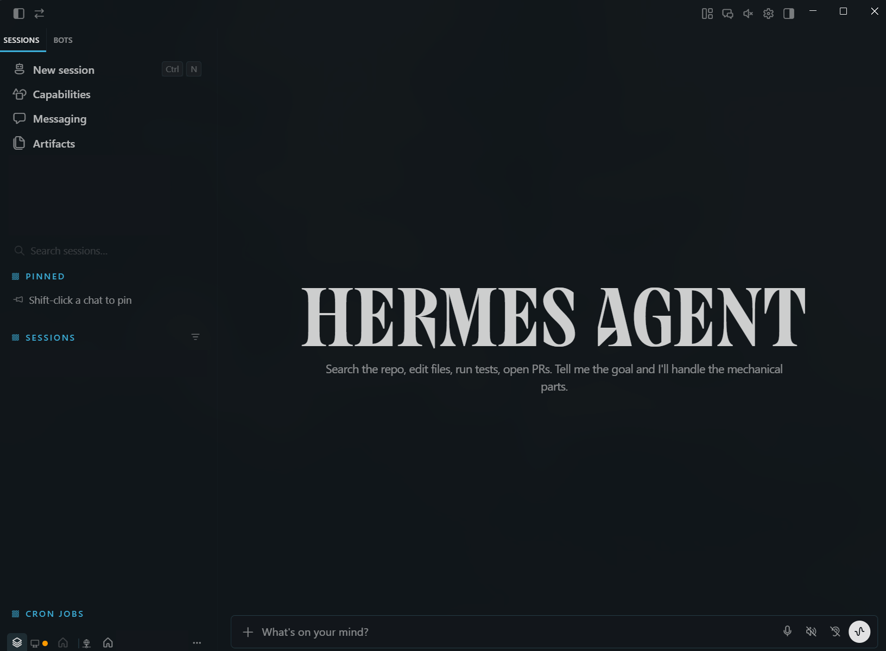

# Glacier Theme — Hermes Desktop plugin



Flat, colorful palette from [Tyriar/vscode-theme-glacier](https://github.com/Tyriar/vscode-theme-glacier) (VS Code port of Joey Figaro’s Glacier Sublime theme).

- **Dark (authentic):** editor `#0E151B`, text `#EFEFEF`, blue accent `#3CADD7`, yellow caret/strings `#FFE792`, coral keywords `#D7503C`
- **Light (derived ice):** snow surfaces with deep glacier blue `#266B85` accent so Appearance light/dark still works
- Includes matching terminal ANSI colors (same accent set)

## Install on Windows

Desktop plugins load from the **local** Windows HERMES_HOME.

1. Create folder:
   ```
   %LOCALAPPDATA%\hermes\desktop-plugins\glacier-theme\
   ```
2. Copy `plugin.js` into that folder.
3. In Hermes Desktop: **Ctrl+K** → **Reload desktop plugins**
4. **Settings → Appearance** → select **Glacier**
5. Toggle light/dark as usual (theme ships both palettes)

Optional: Settings → Plugins should list **Glacier Theme** as enabled.

## Verify

- Theme picker shows **Glacier**
- Dark mode: background `#0E151B`, blue accent `#3CADD7`, yellow terminal cursor `#FFE792`
- Light mode: background `#F3F6F9`, deep blue accent `#266B85`
